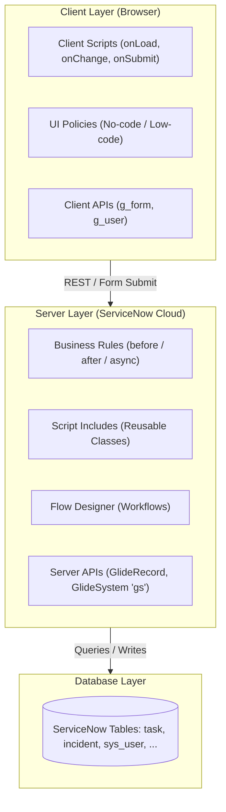

# ServiceNow: Day 1 Guide for JavaScript Developers

A quick-reference guide designed for developers with JavaScript knowledge who are beginning their journey in ServiceNow.

---

## 1. What is ServiceNow?

At its core, ServiceNow is:
> **A cloud-based relational database + automated workflow engine + web application presentation layer.**

### Key Concepts:
* **Everything is a Record in a Table:**
  * Incidents, Change Requests, and Users are database records.
  * Even system configurations, workflows, and JavaScript scripts are stored as records in system tables.
* **`sys_id`:**
  * Every record in ServiceNow has a globally unique 32-character hexadecimal string called `sys_id` (primary key).
* **Inheritance & Base Tables:**
  * Most task-based tables (like `incident`, `problem`, `change_request`) extend from a parent table named `task`.
  * Most asset/device tables extend from `cmdb_ci` (Configuration Item).

---

## 2. Core UI Components

When navigating the ServiceNow interface (Next Experience), you will encounter three primary interfaces:

| UI Component | Description | Example / Shortcut |
| :--- | :--- | :--- |
| **All Menu (Navigator)** | The left navigation panel used to access modules and tables. | Search `incident` or `sys_user` |
| **List View** | Tabular view of records in a table (spreadsheet format). | Type `incident.list` in filter navigator |
| **Form View** | Record detail view displaying fields, sections, and related lists. | Type `incident.do` to open a blank form |

### Navigation Shortcuts:
* `<table_name>.list` &rarr; Opens table list view in current window.
* `<table_name>.LIST` &rarr; Opens table list view in a new tab.
* `<table_name>.do` &rarr; Opens a new record creation form.

---

## 3. Where JavaScript Fits In

ServiceNow scripts run either in the client's web browser or on the ServiceNow application servers (Java-based platform running Rhino / ECMAScript 2021).

### A. Client-Side Scripting (Browser)

Used for user interface interactions, field validation, and dynamic form behavior.

| Script Type | When It Runs | Common Use Case |
| :--- | :--- | :--- |
| **`onLoad()`** | When the form loads in the browser | Pre-populating values, setting field visibility |
| **`onChange()`** | When a specific field value changes | Auto-filling dependent fields |
| **`onSubmit()`** | When the user submits/saves the form | Form validation before saving |

#### Key Client API: `g_form` (GlideForm)
```javascript
function onChange(control, oldValue, newValue, isLoading, isTemplate) {
    if (isLoading || newValue === '') {
        return;
    }

    // Example: If priority is Critical (1), make 'work_notes' mandatory
    if (g_form.getValue('priority') === '1') {
        g_form.setMandatory('work_notes', true);
        g_form.addErrorMessage('Critical priority incidents require work notes.');
    } else {
        g_form.setMandatory('work_notes', false);
    }
}
```

---

### B. Server-Side Scripting (Backend)

Used for database queries, business logic, integrations, and server-side automation.

| Component | Description |
| :--- | :--- |
| **Business Rules** | Server-side logic that triggers before or after database insert, update, or delete operations. |
| **Script Includes** | Reusable backend JavaScript classes and libraries (equivalent to service/utility modules). |
| **Scheduled Script Executions** | Automated batch jobs running on a schedule (cron-like). |

#### Key Server API: `GlideRecord` & `gs` (GlideSystem)
```javascript
(function executeRule(current, previous /*null when async*/) {
    // Example: Query high-priority open incidents
    var gr = new GlideRecord('incident');
    gr.addQuery('active', true);
    gr.addQuery('priority', 1);
    gr.query();

    while (gr.next()) {
        gs.info('Active Critical Incident Found: ' + gr.getValue('number'));
    }
})(current, previous);
```

---

## 4. Fundamental Platform Architecture



---

## 5. Golden Rules for Developers

1. **Configure Before You Code:**
   * Always check if a no-code/low-code solution exists first.
   * Use **UI Policies** instead of Client Scripts when just showing/hiding fields or making them mandatory.
   * Use **Flow Designer** instead of complex Workflow scripts for standard approvals and notifications.
2. **Never Run `GlideRecord` Queries in Client Scripts:**
   * Avoid synchronous calls (`GlideRecord`) in the browser as they freeze the UI.
   * Instead, use asynchronous **`GlideAjax`** calling a client-callable **Script Include**.
3. **PDI Hibernation Maintenance:**
   * Personal Developer Instances (PDIs) hibernate after inactivity and are reclaimed after 10 days of non-use.
   * Log into your instance or developer portal regularly to keep it active.

---

## 6. Day 1 Hands-On Checklist

- [ ] **Log into your PDI:** Check your instance URL (e.g., `https://devXXXXX.service-now.com`).
- [ ] **Explore Table Navigation:** In the All filter navigator, type `incident.list` and press Enter.
- [ ] **Create a Test Incident:** Click **New** or type `incident.do`, fill in a Short Description, and submit.
- [ ] **Experiment with Filters:** In the list view, use the funnel icon to build a filter (e.g., `Active is true` and `Priority is 1 - Critical`).
- [ ] **Inspect Field Definitions:** Right-click any form field label (such as "Short description") &rarr; select **Configure Dictionary** to view its backend table definition, data type, and limits.

